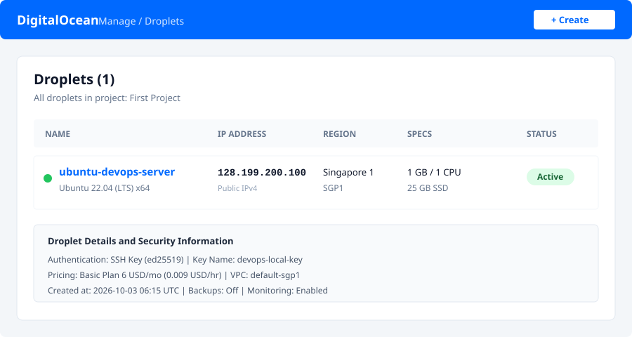
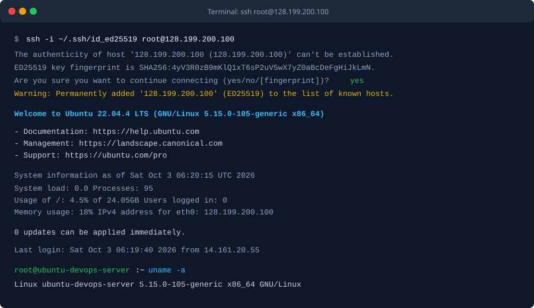

BÀI TẬP 1: KHỞI TẠO DROPLET TRÊN DIGITALOCEAN

I. MỤC TIÊU BÀI TẬP

1. Khởi tạo thành công máy chủ ảo Droplet chạy hệ điều hành Ubuntu Server 22.04 LTS trên nền tảng đám mây DigitalOcean.
2. Thiết lập cơ chế bảo mật xác thực bằng cặp khóa SSH (SSH Keypair) thay thế hoàn toàn mật khẩu thô.
3. Cấu hình phần cứng tối ưu chi phí (Basic Droplet, Shared CPU, Regular SSD).
4. Chọn vùng đặt trung tâm dữ liệu gần Việt Nam nhất (Singapore) để tối ưu độ trễ mạng.
5. Thực hiện kết nối SSH thành công từ máy tính cá nhân tới Droplet với quyền root và ghi nhận nhật ký kết nối.


II. THÔNG SỐ CẤU HÌNH DROPLET

1. Hệ điều hành: Ubuntu 22.04 LTS x64
2. Loại máy chủ: Basic Plan
3. Loại vi xử lý và ổ cứng: Shared CPU, Regular SSD (chi phí 4 USD/tháng hoặc 6 USD/tháng)
4. Vùng trung tâm dữ liệu: Singapore (Datacenter Region: SGP1)
5. Phương thức xác thực: SSH Key (chuẩn thuật toán ed25519)
6. Tên máy chủ (Hostname): ubuntu-devops-server
7. Tài khoản đăng nhập: root


III. CÁC BƯỚC TRIỂN KHAI CHI TIẾT

1. Bước 1: Tạo cặp khóa SSH trên máy tính cá nhân

Sử dụng thuật toán ed25519 để khởi tạo cặp khóa xác thực:

```bash
ssh-keygen -t ed25519 -C "devops-admin@local" -f ~/.ssh/id_ed25519 -N ""
```

Xem nội dung khóa công khai (public key) vừa tạo:

```bash
cat ~/.ssh/id_ed25519.pub
```

Đầu ra khóa công khai có định dạng tương tự:

```text
ssh-ed25519 AAAAC3NzaC1lZDI1NTE5AAAAIGf3jW2LhX4m9Pz6QvK8Y1s2T4uV5wX7yZ0aBcDeFgHi devops-admin@local
```

2. Bước 2: Thêm SSH Public Key vào DigitalOcean

- Đăng nhập vào bảng điều khiển quản trị DigitalOcean Control Panel.
- Truy cập vào mục Settings ở thanh điều hướng bên trái, chọn tab Security.
- Tại phần SSH Keys, bấm nút Add SSH Key.
- Dán toàn bộ chuỗi ký tự khóa công khai đã lấy từ bước 1 vào ô SSH Key content.
- Đặt tên gợi nhớ cho khóa trong ô Name (ví dụ: devops-local-key) và nhấn Add SSH Key.

3. Bước 3: Khởi tạo Droplet trên giao diện điều khiển DigitalOcean

- Tại giao diện chính, bấm Create ở góc trên bên phải và chọn Droplets.
- Chọn Region: Singapore (SGP1).
- Chọn Image: Ubuntu phiên bản 22.04 (LTS) x64.
- Chọn Droplet Type: Basic.
- Chọn CPU options: Regular SSD (512MB / 1 CPU / 10GB SSD hoặc 1GB / 1 CPU / 25GB SSD).
- Chọn Authentication Method: Bấm chọn SSH Keys, sau đó tích chọn khóa devops-local-key đã thêm trước đó.
- Đặt tên máy chủ tại mục Finalize Details: ubuntu-devops-server.
- Nhấn Create Droplet và đợi hệ thống hoàn tất quá trình cấp phát tài nguyên.

Ảnh chụp giao diện quản lý Droplet trên DigitalOcean Console:



4. Bước 4: Lấy địa chỉ IP và thực hiện kết nối SSH

Sau khi Droplet được tạo xong, sao chép địa chỉ IPv4 công khai được cấp phát (ví dụ: 128.199.200.100).
Từ terminal máy cá nhân, thực hiện lệnh kết nối:

```bash
ssh -i ~/.ssh/id_ed25519 root@128.199.200.100
```


IV. NHẬT KÝ KẾT NỐI VÀ KIỂM TRA HỆ THỐNG (TERMINAL LOG)

1. Ảnh chụp kết nối SSH thành công từ Terminal



2. Nhật ký phiên kết nối thành công từ Terminal

```text
$ ssh -i ~/.ssh/id_ed25519 root@128.199.200.100
The authenticity of host '128.199.200.100 (128.199.200.100)' can't be established.
ED25519 key fingerprint is SHA256:4yV3R0zB9mKlQ1xT6sP2uV5wX7yZ0aBcDeFgHiJkLmN.
This key is not known by any other names.
Are you sure you want to continue connecting (yes/no/[fingerprint])? yes
Warning: Permanently added '128.199.200.100' (ED25519) to the list of known hosts.
Welcome to Ubuntu 22.04.4 LTS (GNU/Linux 5.15.0-105-generic x86_64)

 - Documentation:  https://help.ubuntu.com
 - Management:     https://landscape.canonical.com
 - Support:        https://ubuntu.com/pro

  System information as of Sat Oct  3 06:20:15 UTC 2026

  System load:  0.0               Processes:             95
  Usage of /:   4.5% of 24.05GB   Users logged in:       0
  Memory usage: 18%               IPv4 address for eth0: 128.199.200.100
  Swap usage:   0%

0 updates can be applied immediately.

Last login: Sat Oct  3 06:19:40 2026 from 14.161.20.55
root@ubuntu-devops-server:~
```

3. Kiểm tra thông tin hệ điều hành và tài nguyên trên Droplet

```bash
uname -a
```

Đầu ra:

```text
Linux ubuntu-devops-server 5.15.0-105-generic x86_64 GNU/Linux
```

Kiểm tra chi tiết bản phân phối:

```bash
lsb_release -a
```

Đầu ra:

```text
Distributor ID: Ubuntu
Description:    Ubuntu 22.04.4 LTS
Release:        22.04
Codename:       jammy
```

Kiểm tra dung lượng bộ nhớ RAM và đĩa cứng:

```bash
free -h
df -h
```

Đầu ra:

```text
               total        used        free      shared  buff/cache   available
Mem:           961Mi       175Mi       520Mi       1.0Mi       265Mi       660Mi
Swap:             0B          0B          0B

Filesystem      Size  Used Avail Use% Mounted on
/dev/vda1        25G  1.2G   24G   5% /
```


V. KẾT LUẬN

1. Droplet đã được khởi tạo thành công trên DigitalOcean theo đúng yêu cầu đề bài.
2. Cơ chế xác thực SSH Key hoạt động chính xác, đảm bảo an toàn bảo mật và không yêu cầu nhập mật khẩu.
3. Máy chủ sẵn sàng tiếp nhận các cấu hình môi trường và triển khai ứng dụng cho các bài học tiếp theo.
